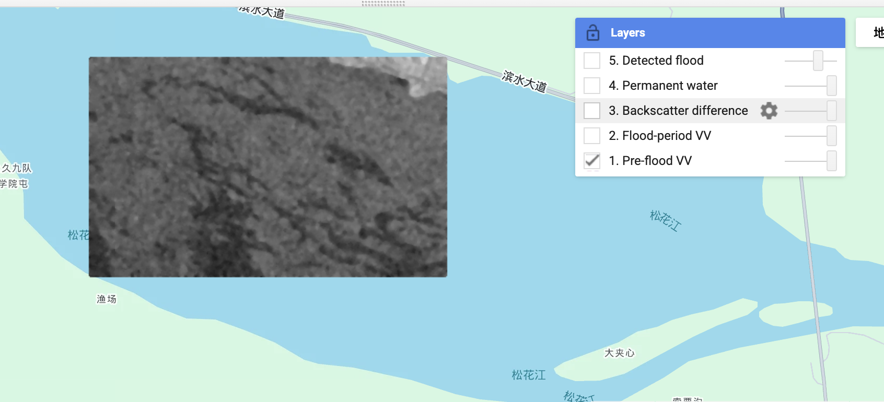
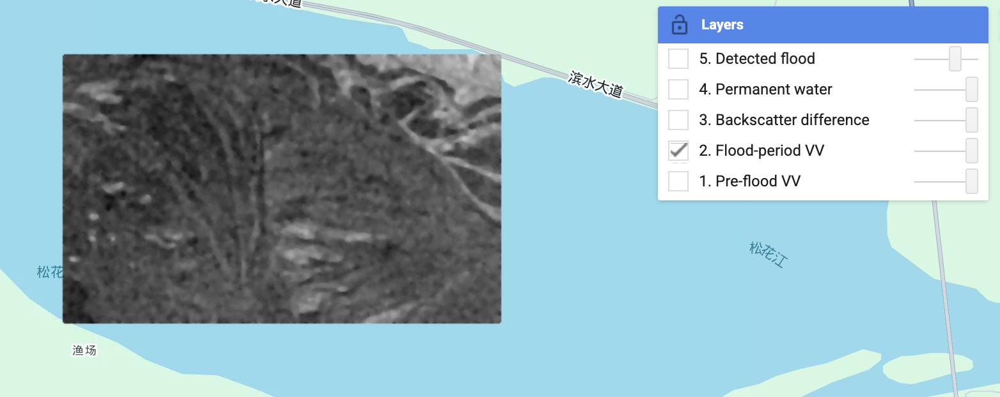
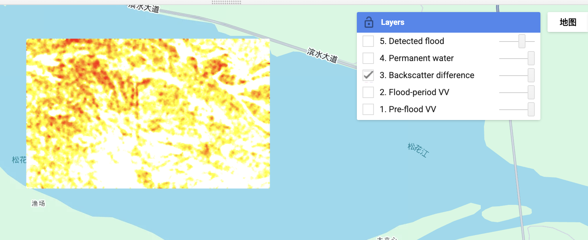
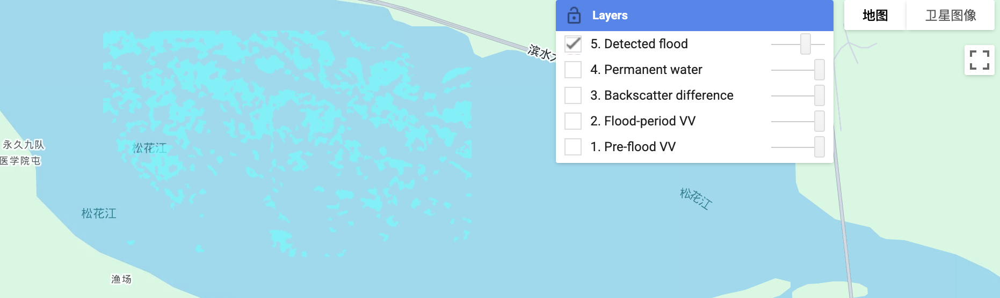

# Sentinel-1 Flood Spatio-Temporal Monitoring

This project reconstructs a remote-sensing workflow for identifying potential flood inundation using Sentinel-1 SAR imagery in Google Earth Engine.

The analysis compares pre-flood and flood-period VV backscatter, controls for Sentinel-1 acquisition geometry, removes persistent surface water, filters small isolated detections, and estimates the area classified as potential inundation.

## Study Area

The study area is located along the Songhua River in northeastern China.

Approximate extent:

- West: 127.12984°E
- East: 127.18786°E
- South: 45.99357°N
- North: 46.01813°N

## Data

Sentinel-1 SAR imagery was accessed through Google Earth Engine using:

`COPERNICUS/S1_GRD`

The analysis used:

- Instrument mode: IW
- Polarisation: VV
- Orbit direction: Descending
- Relative orbit: 105
- Pre-flood period: 2021-06-01 to 2021-07-01
- Flood-period window: 2021-07-02 to 2021-08-01

Two Sentinel-1 images were retained for each period after restricting the collections to relative orbit 105.

Persistent surface water was identified using:

`JRC/GSW1_4/GlobalSurfaceWater`

Pixels with water occurrence greater than or equal to 90% were treated as permanent water.

## Method

Median VV composites were created separately for the pre-flood and flood-period image collections.

A 50 m focal median filter was applied to reduce small-scale SAR speckle.

Backscatter change was calculated as:

`pre-flood VV - flood-period VV`

A pixel was classified as a flood candidate when:

- the VV backscatter decrease was greater than 2 dB;
- flood-period VV was below -16 dB;
- pre-flood VV was greater than or equal to -16 dB;
- the pixel was not classified as permanent water by the JRC dataset.

Small isolated detections were further reduced using connected-pixel filtering. Groups containing fewer than eight connected pixels were excluded.

## Results

The final workflow identified approximately:

**3.2699 km²**

of potential inundation within the study area.

Equivalent area:

- 3,269,872 m²
- 326.99 ha
- 3.2699 km²

This value represents an algorithm-derived flood candidate area rather than an independently validated estimate of true flood extent.

## Result Figures

### Pre-flood VV composite



### Flood-period VV composite



### Backscatter difference



### Detected flood candidate extent



## Repository Structure

```text
flood-spatiotemporal-monitoring/
├── README.md
├── flood_detection.js
├── data/
│   └── README.md
├── exports/
│   ├── README.md
│   ├── flood_area_summary_2021.csv
│   ├── sentinel1_difference_db_2021.tif
│   └── sentinel1_flood_extent_2021.tif
└── results/
    ├── README.md
    ├── pre_flood_vv.png
    ├── flood_period_vv.png
    ├── backscatter_difference.png
    └── detected_flood_extent.png
```

## Code

The complete Google Earth Engine workflow is stored in:

`flood_detection.js`

The script includes Sentinel-1 filtering, relative-orbit control, median compositing, speckle reduction, backscatter change detection, permanent-water masking, connected-pixel filtering, area estimation and export.

## Limitations

The detected flood extent is sensitive to the selected temporal windows, VV thresholds and surface-water masking criteria.

Seasonal water, wet soil, vegetation changes and other changes in radar backscatter may contribute to false detections.

The result has not been independently validated using field observations or an external reference flood map and should therefore be interpreted as potential inundation rather than confirmed flood extent.

## Tools

- Google Earth Engine
- JavaScript
- Sentinel-1 SAR
- JRC Global Surface Water
- Remote sensing
- Change detection
- Flood mapping

## Author

Chenxi Tian  
BSc (Hons) Geophysics  
School of GeoSciences  
University of Edinburgh
